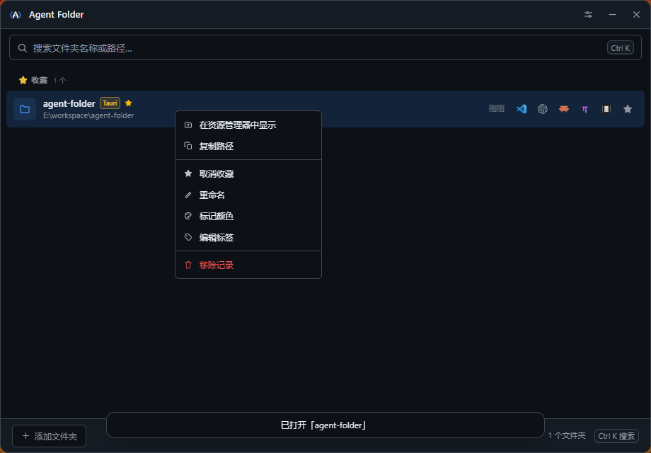
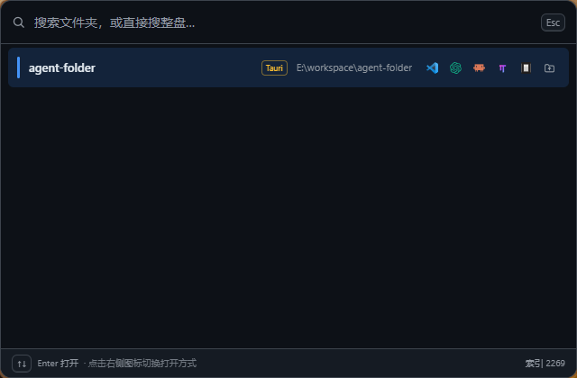

# Agent Folder

[简体中文](README.zh-CN.md)

Agent Folder is a lightweight Windows desktop app for organizing frequently used folders and opening them quickly in a code editor or File Explorer.

## Screenshots

**Main window** — six inline actions per row, everything else in the right-click menu.



**Quick-launch palette** — search saved records and the disk index together, then pick the target with the icons on the right.



## Features

- Pin favorite folders and sort by recent usage
- Fuzzy search by folder name, path, and tags
- Browse the directory tree; disk search runs on a persistent index, so typing searches the whole disk instantly
- The quick-launch palette searches saved records and disk folders together, grouped by source
- Pick VS Code, Codex, Claude Code, omp, opencode, or File Explorer directly from a palette row
- Open folders with VS Code, VS Code Insiders, Cursor, Windsurf, or File Explorer
- Launch Codex CLI or Claude Code in the selected folder; Claude Code supports a no-argument default mode and configurable permission modes
- Add tags and colors; identify common project types
- Stay in the system tray and use global shortcuts; both the main-window and quick-launch hotkeys are configurable, and clearing the quick-launch one disables it
- Row actions stay at six high-frequency buttons; favorite, rename, color, tags, copy path, reveal, and remove live in a right-click menu (`Shift+F10` works too)
- The palette closes on `Esc`, when it loses focus, or after eight seconds without input
- Import and export local JSON data; history is capped at 500 records while favorites are preserved
- Storage safety: a damaged `data.json` is backed up before anything else happens, and a read-only protection mode prevents silent overwrites when the backup itself fails
- Per-hotkey registration status in settings, with a retry button, so a shortcut conflict is visible instead of failing silently
- Atomic, rollback-safe export and merge-on-import that reports the exact number of records added, trimmed, and skipped

## Current Version

The latest release is **v1.2.0**. Download it from [GitHub Releases](https://github.com/jin-liquor/agent-folder/releases).

## Installation

Download the latest `*_x64-setup.exe` from [GitHub Releases](https://github.com/jin-liquor/agent-folder/releases) and run the installer.

Requirements: Windows 10 or later and the Microsoft Edge WebView2 Runtime (usually preinstalled on Windows 11). Launch the installed app from the Start menu. Avoid running a built executable directly from a working directory with a low-integrity security label, as Windows may block system-tray icon registration.

## Quick Start

1. Launch Agent Folder.
2. Choose **Add Folder** to browse, or just type a keyword to search the indexed disk folders.
3. Select a project and press `Enter` to open it with the current default editor.
4. Favorite frequently used folders and search them later from the main window or quick-launch palette.

If a project is outside the default scan roots, add its parent directory in **Settings → Scan Roots**. Adding records, favorites, or settings never moves, modifies, or deletes project files on disk.

## Shortcuts

| Shortcut | Action |
|---|---|
| `Ctrl+K` | Focus search |
| `↑` / `↓` | Move through results |
| `Enter` | Open the selected project |
| `Ctrl+D` | Toggle favorite |
| `Delete` | Remove a record without deleting its folder |
| `Ctrl+,` | Open settings |
| `Esc` | Close a panel or clear search |
| `Ctrl+Alt+V` | Show or hide the main window; configurable in settings |
| `Ctrl+Space` | Show or hide the quick-launch palette; changeable in settings, clear it to disable |
| `Shift+F10` / right-click | Open the action menu for the focused row |

Inside the palette only `↑` / `↓` and `Enter` are bound; switch the launch target with the icon buttons on the right of each row.

The title-bar minimize button hides the app to the tray. The close button follows the **Minimize to tray on close** setting. To exit completely, right-click the tray icon and choose **Quit**.

## Privacy and Data

Folder records and settings are stored locally at `%APPDATA%\agent-folder\data.json`. The app does not upload this data or collect usage analytics. JSON import and export are user-initiated. Automatic updates are not currently included; download and install new versions manually from GitHub Releases.

If `data.json` cannot be parsed, the app backs up the original file next to it before falling back, and settings shows the backup path together with **Reveal backup**, **Export backup**, **Restore backup**, and **Reload** actions. If creating the backup fails, the app enters read-only protection instead of overwriting your data.

## Build from Source

Requires Node.js, pnpm, the Rust toolchain, and the Windows WebView2 Runtime.

```powershell
pnpm install
pnpm build
pnpm test
cargo fmt --manifest-path src-tauri/Cargo.toml --check
cargo test --manifest-path src-tauri/Cargo.toml --release --offline
$env:CI = "true"
pnpm tauri build
```

The installer is generated in `src-tauri/target/release/bundle/nsis/`.

## Developer Documentation

Development rules, architecture notes, release process, and implementation plans are maintained in the local `AGENT.md` and `Plan/` directory. They are intentionally excluded from Git tracking.

## License

[MIT License](LICENSE)
