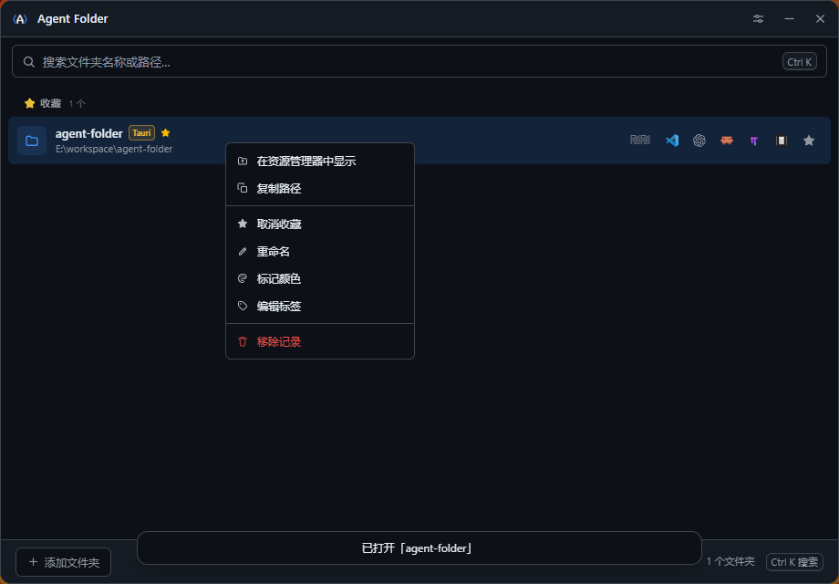
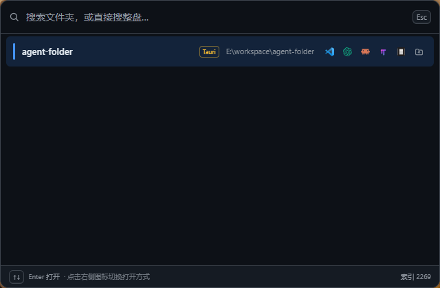

# Agent Folder

[English](README.md)

Agent Folder 是一个面向 Windows 的轻量级桌面工具，用于管理常用文件夹，并快速在代码编辑器或资源管理器中打开。

## 界面截图

**主窗口** —— 行内 6 个高频按钮，其余操作在右键菜单里。



**快速启动浮窗** —— 已保存记录与磁盘索引一起搜索，右侧图标切换打开方式。



## 功能

- 收藏常用文件夹，并按最近使用情况排序
- 按名称、路径和标签进行模糊搜索
- 浏览目录树；磁盘检索由常驻索引提供，输入即搜全盘
- 快速启动浮窗同时搜索已保存记录与磁盘目录，结果分组展示
- 浮窗行内可直接选择 VS Code、Codex、Claude Code、omp、opencode 或资源管理器打开
- 使用 VS Code、VS Code Insiders、Cursor、Windsurf 或资源管理器打开文件夹
- 在选中文件夹中启动 codex、Claude Code、omp 或 opencode；每种 CLI 一个预设下拉栏
- 预设可自行增删改：内置模式直接选用，也可以新建参数组合、改名、改参数或删除
- 首次启动自动探测各 CLI 的可执行文件路径并保存，设置页可查看、重新探测或手动纠正
- 主窗口行内保留 6 个高频按钮，收藏、重命名、颜色、标签、复制路径、移除等收进右键菜单（`Shift+F10` 同效）
- 浮窗在 `Esc`、失去焦点或 8 秒无操作后自动收起
- 为项目添加标签和颜色，并识别常见项目类型
- 使用系统托盘、全局快捷键和快速启动浮窗；两处快捷键都可在设置中修改，快速启动快捷键可清空禁用
- 界面支持简体中文与英文，覆盖设置、快速启动、提示消息和托盘菜单
- 支持自动检测并手动管理 Codex、Claude Code、omp 和 opencode 的可执行文件路径
- 导入、导出本地 JSON 数据；每个用户最多保留 500 条历史记录，收藏不会因历史裁剪而删除
- 存储安全：`data.json` 损坏时先备份再降级；备份本身失败时进入只读保护，不再静默覆盖原数据
- 设置页分别显示各全局快捷键的注册状态并提供重试，快捷键冲突不再静默失败
- 导出采用原子写入与回滚，导入按路径合并且报告实际新增、裁剪与跳过的数量

## 当前版本

最新版本为 **v1.2.3**，请从 [GitHub Releases](https://github.com/jin-liquor/agent-folder/releases) 下载。

## 安装

从 [GitHub Releases](https://github.com/jin-liquor/agent-folder/releases) 下载最新的 `*_x64-setup.exe`，运行安装程序即可。

系统要求：Windows 10 或更高版本，以及 Microsoft Edge WebView2 Runtime（Windows 11 通常已预装）。建议安装后从开始菜单启动应用。不要直接从受低完整性权限限制的工作目录运行构建产物，否则 Windows 可能阻止系统托盘图标注册。

## 快速开始

1. 启动 Agent Folder。
2. 选择「添加文件夹」浏览磁盘，或直接输入关键词搜索已建立索引的磁盘目录。
3. 选择项目并按 `Enter`，使用当前默认编辑器打开。
4. 将常用目录加入收藏，之后可在主窗口或快速启动浮窗中搜索。

如果项目不在默认扫描范围内，请在「设置 → 磁盘扫描范围」添加对应目录。添加记录、收藏或设置不会移动、修改或删除磁盘上的项目文件。

## 快捷键

| 快捷键 | 操作 |
|---|---|
| `Ctrl+K` | 聚焦搜索框 |
| `↑` / `↓` | 选择列表项 |
| `Enter` | 打开选中项目 |
| `Ctrl+D` | 收藏或取消收藏 |
| `Delete` | 移除记录，不删除实际文件夹 |
| `Ctrl+,` | 打开设置 |
| `Esc` | 关闭面板或清空搜索 |
| `Shift+F10` / 右键 | 打开当前行的操作菜单 |
| `Ctrl+Alt+V` | 显示或隐藏主窗口，可在设置中更改 |
| `Ctrl+Space` | 显示或隐藏快速启动浮窗，可在设置中更改或清空禁用 |

快速启动浮窗内只保留 `↑` / `↓` 选择与 `Enter` 打开；切换打开方式请点击行右侧的图标按钮。

标题栏最小化按钮会将窗口最小化到任务栏。关闭按钮根据「关闭时隐藏到系统托盘」设置决定隐藏到托盘或退出应用。托盘菜单的「显示窗口」可恢复主窗口，「退出」会完全结束应用。

## 隐私与数据

Agent Folder 将文件夹记录和设置保存在本机：`%APPDATA%\agent-folder\data.json`。应用不上传这些数据，也不收集使用统计。JSON 导入和导出由用户主动操作。项目当前不包含自动更新器；新版本通过 GitHub Releases 手动下载并安装。

如果 `data.json` 无法解析，应用会先把原文件备份到同目录再降级加载；设置页会显示备份路径，并提供「定位备份」「导出备份」「恢复备份」「重新加载」。如果备份本身失败，应用进入只读保护，不会覆盖你的数据。

## 从源码构建

需要 Node.js、pnpm、Rust 工具链和 Windows WebView2 Runtime。

```powershell
pnpm install
pnpm build
pnpm test
cargo fmt --manifest-path src-tauri/Cargo.toml --check
cargo test --manifest-path src-tauri/Cargo.toml --release --offline
$env:CI = "true"
pnpm tauri build
```

安装包位于 `src-tauri/target/release/bundle/nsis/`。

## 开发文档

开发规范、架构说明、版本发布流程和实施计划维护在本地 `AGENT.md` 与 `Plan/` 目录中，按项目约定不加入 Git 跟踪。

## 许可

[MIT License](LICENSE)
